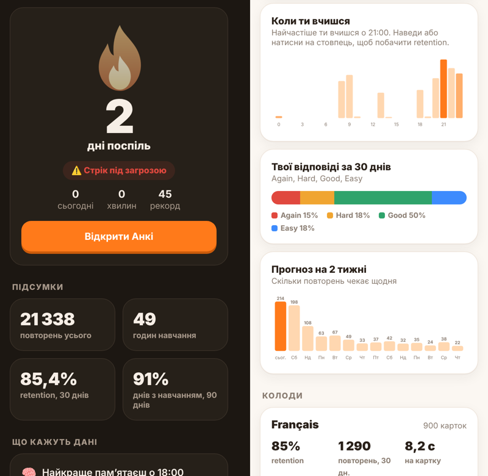

# Anki Streak

A personal learning-analytics pipeline for [Anki](https://apps.ankiweb.net/). It pulls my review history from AnkiWeb every few hours, turns it into a dashboard I can install on my iPhone, and sends Duolingo-style reminders that get more insistent the later it gets without a study session.



*Screenshot generated from test data.*

## What it does

- **Collects** the full review log (`revlog`) from AnkiWeb using Anki's official open-source Python library. Download only: the script never uploads, so it cannot change the real collection.
- **Analyses** every review: streaks, daily heatmap, weekly volume and retention, retention by hour of day, weekday patterns, answer-button mix, per-deck card maturity, leeches and a 14-day workload forecast.
- **Explains** the numbers in plain language ("you remember best at 18:00, worst at 23:00").
- **Nags** through Web Push notifications and email at 19:00, 21:00, 22:00 and 23:00 if no reviews were logged that day, and celebrates when the streak is saved.
- **Publishes** a cleaned dataset, `docs/data/reviews.csv`, with one row per review (no card text).

## How it works

```
GitHub Actions (cron, evenings)
  ├─ collector/sync.py     AnkiWeb → fresh read-only copy of the collection
  ├─ collector/analyze.py  revlog → docs/data/stats.json + reviews.csv
  └─ collector/remind.py   no reviews today? → Web Push + Gmail
GitHub Pages
  └─ docs/                 installable PWA: dashboard, service worker, push subscription
```

No server and no paid services. Everything runs on GitHub's free tier.

## Metrics, defined

| Metric | Definition |
|---|---|
| Streak | Consecutive study days. A day starts at 04:00 local time, like in Anki. |
| Retention | Share of answers on review cards (not new or relearning) that were not "Again". |
| Mature retention | The same, only for cards whose previous interval was 21+ days. |
| Consistency | Share of the last 90 days with at least one review. |
| Leech | Card forgotten 8 or more times. |
| Forecast | Review cards due on each of the next 14 days. |

## Setup

1. **Pages:** Settings → Pages → Source: *Deploy from a branch*, branch `main`, folder `/docs`.
2. **Secrets:** Settings → Secrets and variables → Actions:
   - `ANKI_USERNAME`, `ANKI_PASSWORD`: AnkiWeb login
   - `GMAIL_USER`, `GMAIL_APP_PASSWORD`: Gmail address and an [app password](https://myaccount.google.com/apppasswords) (needs 2-step verification); optional `EMAIL_TO`
   - `PUSH_CONFIG`: generated by the app itself (step 4)
3. **First run:** Actions → *Update stats and nag* → *Run workflow*.
4. **Phone:** open the Pages URL in Safari → Share → Add to Home Screen → open the app → *Enable notifications* → copy the text into the `PUSH_CONFIG` secret. Requires iOS 16.4+.
5. **Test:** run the workflow again with *Send a test notification* ticked.

Personal settings (time zone, reminder hours, email on/off) are in `collector/settings.py`. Message texts are in `collector/remind.py`.

## Privacy

The downloaded collection is deleted at the end of every run and is git-ignored. Only aggregated numbers, deck names and anonymous card IDs are committed. The push private key exists only in the GitHub secret.

## Built with

Python (anki, sqlite3, pywebpush), vanilla JavaScript and SVG, GitHub Actions, GitHub Pages, Web Push (VAPID).
